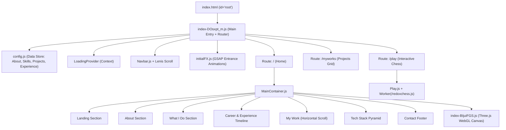

# Reverse Engineering & Architecture Blueprint: redoyanulhaque.me

এই ডকুমেন্টটিতে **https://www.redoyanulhaque.me/** সাইটটির সম্পূর্ণ রিভার্স-ইঞ্জিনিয়ারিং অডিট, ইন্টারনাল আর্কিটেকচার, জাভাস্ক্রিপ্ট বান্ডেল, স্টেট ম্যানেজমেন্ট, ইভেন্ট লিসেনার, নেটওয়ার্ক কল এবং অনুরূপ একটি প্রিমিয়াম থ্রি-ডি পোর্টফোলিও তৈরির স্টেপ-বাই-স্টেপ ব্লুপ্রিন্ট প্রস্তুত করা হয়েছে।

---

## ১. ওভারভিউ ও টেকনোলজি স্ট্যাক (Tech Stack)

| স্তর / ক্যাটাগরি | ব্যবহৃত প্রযুক্তি / লাইব্রেরি | ভূমিকা ও উদ্দেশ্য |
| :--- | :--- | :--- |
| **ফ্রন্টএন্ড ফ্রেমওয়ার্ক** | **React 18** (Vite Bundler) | কম্পোনেন্ট-ভিত্তিক SPA আর্কিটেকচার। |
| **রাউটিং** | **React Router v6** (`BrowserRouter`, `Routes`, `Route`) | পেজ রাউটিং (`/`, `/myworks`, `/play`)। |
| **থ্রি-ডি রেন্ডারিং** | **Three.js** + **GLTFLoader** + **DRACOLoader** | ইন্টারেক্টিভ থ্রি-ডি ক্যারেক্টার ও সিন রেন্ডারিং। |
| **অ্যানিমেশন ইঞ্জিন** | **GSAP (GreenSock)** + **ScrollTrigger** | স্ক্রল-বেজড পিনিং, হরাইজন্টাল স্ক্রলিং এবং টেক্সট স্প্লিট অ্যানিমেশন। |
| **স্মুথ স্ক্রলিং** | **Lenis Scroll v1.3.15** | ওয়েবসাইটের বাটার-স্মুথ স্ক্রল ফিজিক্স। |
| **টেক্সট এফেক্টস** | কাস্টম **SplitText** ক্লাস (ইনলাইন লিখিত) | টাইটেল ও প্যারাগ্রাফ অক্ষর/শব্দ ভেঙে স্ট্যাগার অ্যানিমেশন। |
| **টাইপোগ্রাফি** | **Geist** (Google Fonts) | আধুনিক মিনিমালিস্টিক স্যান-সেরিফ ফন্ট। |
| **মারকুই / ক্যারোসেল** | **react-fast-marquee** | লোডার স্ক্রিনে ইনফিনিট স্ক্রলিং টেক্সট। |
| **ওয়েব ওয়ার্কার গেম** | **chess.js** + **Web Worker** (`redoxchess.js`) | ক্লায়েন্ট সাইড UCI চেস ইঞ্জিন গেম প্লে। |
| **সিকিউরিটি / অ্যাসেট প্রোটেকশন** | **Web Crypto API (SubtleCrypto AES-CBC)** | 3D মডেল ফাইল এনক্রিপ্ট করে ক্লায়েন্টে ডিক্রিপ্ট করা। |
| **হোস্টিং ও অ্যানালিটিক্স** | **Vercel** (`@vercel/analytics`, `@vercel/speed-insights`) | এজ হোস্টিং, পেজভিউ ও পারফরম্যান্স ট্র্যাকিং। |

---

## ২. নেটওয়ার্ক ও এপিআই অ্যানালাইসিস (Network & APIs)

### ক. ব্যাকএন্ড এপিআই আছে কি?
* **কোনো কাস্টম ব্যাকএন্ড সার্ভার নেই (100% Serverless / Client-Side SPA):** সাইটটিতে কোনো এক্সপ্রেস, পাইথন, বা ফায়ারবেস ব্যাকএন্ড কল নেই। 
* **যোগাযোগের মাধ্যম:** কোনো ফর্ম সাবমিট এপিআই (যেমন Formspree বা Resend) ব্যবহার করা হয়নি; সরাসরি `mailto:redoyanul1234@gmail.com` লিঙ্ক ও সোশ্যাল মিডিয়া প্রোফাইল লিঙ্ক দিয়ে যোগাযোগ নিশ্চিত করা হয়েছে।

### খ. আউটগোয়িং নেটওয়ার্ক রিকোয়েস্টের তালিকা:
1. **স্ট্যাটিক জেএস ও সিএসএস চাঙ্কস (Vite code splitting):**
   - `assets/index-DOsxpt_m.js` (মেইন এন্ট্রি)
   - `assets/Navbar-CBrEUVVF.js`
   - `assets/MainContainer-CNANTDSP.js`
   - `assets/config-DAcyC9gd.js` (সাইটের সমস্ত ডাটা)
   - `assets/index-BIjuiFGS.js` (Three.js 3D সিন)
   - `assets/Play-xPN_xUXd.js` (চেস গেম পেজ)
   - `assets/MyWorks-D-9Nr59e.js` (অল প্রজেক্টস পেজ)
2. **এনক্রিপ্টেড ৩ডি অ্যাসেটস:**
   - `GET /models/character.enc` (AES-CBC এনক্রিপ্টেড 3D ক্যারেক্টার গ্লিব ফাইল)
   - `GET /models/char_enviorment.hdr` (Three.js এর এনভায়রনমেন্টাল রিফ্লেকশন ম্যাপ)
   - `GET /draco/*` (DRACO ডিকম্প্রেশন ওয়্যার্কার্স ও ওয়াশম ফাইল)
3. **মিডিয়া ও ভিডিও:**
   - `GET /video/video.webm` (টেক স্ট্যাক সেকশনের ব্যাকগ্রাউন্ড ভিডিও লুপ)
   - `GET /images/mypicnbg.png` (মোবাইল ডিভাইসের ৩ডি ফলব্যাক পোর্ট্রেট)
   - `GET /images/*.png` (প্রজেক্ট থাম্বনেইল)
4. **এক্সটার্নাল সিডিএন (CDNs):**
   - `cdn.jsdelivr.net` (Tech stack এর জন্য DevIcons SVG লোগো)
   - `fonts.googleapis.com` (Geist Font ফ্যামিলি)
5. **টেলিমেট্রি ও অ্যানালিটিক্স:**
   - `POST /_vercel/insights/script.js` (@vercel/analytics - পেজভিউ ট্র্যাকিং)
   - `POST /_vercel/speed-insights/vitals` (@vercel/speed-insights - Core Web Vitals)
6. **ওয়েব ওয়ার্কার ব্যাকগ্রাউন্ড থ্রেড:**
   - `GET /redoxchess.js` (`new Worker('/redoxchess.js')` - চেস এআই চাল গণনার জন্য ব্রাউজার ব্যাকগ্রাউন্ড থ্রেড)

---

## ৩. জাভাস্ক্রিপ্ট বান্ডেল ও কোড আর্কিটেকচার (JavaScript Bundles)

### ক. কোড স্ট্রাকচার ও চাঙ্কিং (Vite Code-Splitting)
সাইটটি Vite দিয়ে বান্ডেল করা হয়েছে। প্রধান ফিচার অনুযায়ী আলাদা লেজি-লোডেড চাঙ্ক তৈরি করা হয়েছে:



### খ. সিঙ্গেল সোর্স অফ ট্রুথ (Data Driven Portfolio): `config.js`
এই সাইটের সবচেয়ে বড় সুবিধা হলো—সব তথ্য কোনো ডাটাবেস বা হার্ডকোডেড কম্পোনেন্টে না রেখে একটি সিঙ্গেল সেন্ট্রালাইজড কনফিগ ফাইলে রাখা হয়েছে:
- `developer`: নাম, টাইটেল, বায়ো।
- `social`: সোশ্যাল লিঙ্ক ও লোকেশন।
- `about`: পরিচিতি।
- `experiences`: ক্যারিয়ার টাইমলাইনের তালিকা (কোম্পানি, সময়কাল, দায়িত্ব, ব্যবহৃত টেকনোলজি)।
- `projects`: প্রজেক্টের টাইটেল, ক্যাটাগরি, টেক্সট্যাক, ইমেজ ও লাইভ লিঙ্ক।
- `skills`: AI ডেভেলপমেন্ট এবং ফুল-স্ট্যাক স্কিল ও টুলসের অ্যারে।
- `contact`: সব সোশ্যাল মিডিয়া ইউআরএল।

### গ. স্টেট ম্যানেজমেন্ট (State Management)
1. **`LoadingContext` (`N = createContext(null)`):**
   - সাইট লোডিং ট্র্যাকিং করে (`isLoading`, `percent`, `setIsLoading`, `setLoading`)।
   - ৩ডি মডেল লোড হওয়া এবং প্রগ্রেস পার্সেন্টেজ সিঙ্ক করে।
   - লোডিং ১০০% সম্পন্ন হলে `initialFX()` ফাংশন কল করে এন্ট্রান্স অ্যানিমেশন চালু করে।
2. **লোকাল কম্পোনেন্ট স্টেট (`useState` & `useRef`):**
   - **রেসপনসিভ সুইচিং:** `window.innerWidth > 1024` হলে তবেই Three.js ৩ডি ক্যানভাস মাউন্ট করা হয়। মোবাইল স্ক্রিনে ৩ডি বাদ দিয়ে অপ্টিমাইজড 2D ইমেজ রেন্ডার হয়।
   - **পারফরম্যান্স অপ্টিমাইজেশন:** ৩ডি ক্যানভাস ইনিশিয়ালাইজ করতে `window.requestIdleCallback` ব্যবহার করা হয়েছে, যাতে ব্রাউজারের মেইন থ্রেড ব্লক না হয়।
   - **চেস গেম স্টেট:** `/play` পেজে `chess.js` ইনস্ট্যান্স দিয়ে বোর্ডের FEN স্টেট, বৈধ চাল এবং গেম ওভার স্টেট ট্র্যাক করা হয়।

---

## ৪. ইভেন্ট লিসেনার ও ইন্টারঅ্যাকশন লজিক (Event Listeners)

| লিসেনার টার্গেট | ইভেন্ট | ফাংশন ও রেসপন্স |
| :--- | :--- | :--- |
| **`document`** | `mousemove` | **১. কাস্টম কার্সার ইনর্শিয়া:** কার্সার এলিমেন্ট মাউসের পেছনে পেছনে স্মুথলি চলে (`pos += (target - pos) / 6`)।<br>**২. ৩ডি মডেলের মুখ মাউস ফলো করা:** মাউসের কোঅর্ডিনেট -১ থেকে +১ এ কনভার্ট করে 3D ক্যারেক্টারের `spine006` হেড-বোন রোটেশন আপডেট করে।<br>**৩. ম্যাগনেটিক সোশ্যাল আইকন:** মাউস আইকনের কাছে এলে আইকনটি মাউসের দিকে আকর্ষিত হয়। |
| **`[data-cursor]`** | `mouseover` / `mouseout` | লিঙ্কের ওপর মাউস নিলে কার্সারের আকার বড়/ছোট হওয়া বা আইকন স্ন্যাপ করা (`cursor-icons`, `cursor-disable`)। |
| **`window`** | `resize` | ১. Three.js ক্যামেরা অ্যাসপেক্ট রেশিও এবং রেন্ডারার সাইজ অ্যাডজাস্ট করে।<br>২. Lenis স্ক্রল বাউন্ডারি রিক্যালকুলেট করে।<br>৩. GSAP `ScrollTrigger.refresh()` কল করে হরাইজন্টাল স্ক্রল দূরত্ব আপডেট করে। |
| **`.header ul a`** | `click` | সাধারণ জাম্পিং স্ক্রল বন্ধ করে `lenis.scrollTo(target, { duration: 1.5 })` দিয়ে বাটার-স্মুথ স্ক্রলিং চালায়। |
| **`.what-content`** | `click` / `hover` | ফ্লিপ/অ্যাকর্ডিয়ন এফেক্ট: যে কার্ডে হোভার বা ক্লিক হয় তা বড় হয় (`min-height: 67%`), অন্য কার্ডগুলো ছোট হয়ে যায় (`min-height: 33%`)। |
| **`.work-section`** | `scroll` (Wheel) | **হরাইজন্টাল পিন স্ক্রলিং:** GSAP ScrollTrigger স্ক্রিনকে স্ক্রল-লক (pin) করে এবং উল্লম্ব স্ক্রল ইনপুটকে আনুভূমিক ট্রান্সলেশনে (`x: -totalWidth`) রূপান্তর করে। |
| **`/play` বোর্ড** | `click` | ঘুঁটি সিলেক্ট এবং গন্তব্য স্কয়ারে ক্লিক করলে চাল ভ্যালিডেট হয় এবং Web Worker-এ `position fen ...` ও `go depth 15` পাঠানো হয়। |

---

## ৫. স্পেশাল ইঞ্জিনিয়ারিং ফিচারস (Advanced Tricks)

### ১. ৩ডি মডেলের ক্লায়েন্ট-সাইড এনক্রিপশন (Asset Protection)
সাইট নির্মাতা তার কাস্টম তৈরি 3D ক্যারেক্টার মডেলটি চুরি হওয়া ঠেকাতে সরাসরি `.glb` আপলোড না করে AES এনক্রিপ্ট করে `.enc` আকারে সার্ভারে রেখেছেন। ব্রাউজারে কোডটি রান হওয়ার সময় Web Crypto API দিয়ে ডিক্রিপ্ট হয়:
```javascript
// ১. প্রথম ১৬ বাইট হলো Initialization Vector (IV)
// ২. বাকি বাইটগুলো সাইফারটেক্সট
// ৩. কী হিসেবে পাসওয়ার্ড হ্যাশ (SHA-256): "Character3D#@"
// ৪. AES-CBC ডিক্রিপশনের পর Blob তৈরি করে DRACOLoader দিয়ে Three.js এ পাস করা হয়
```

### ২. GSAP ScrollTrigger দিয়ে হরাইজন্টাল প্রজেক্ট শোকেস
সাধারণ সিএসএস হরাইজন্টাল স্ক্রলিং না করে GSAP ScrollTrigger দিয়ে স্ক্রিনকে পিন করে স্ক্রল দূরত্বের সমান পিক্সেল ক্যালকুলেট করে প্রজেক্ট লিস্টকে আনুভূমিকভাবে বামে সরানো হয়েছে:
```javascript
gsap.timeline({
  scrollTrigger: {
    trigger: ".work-section",
    start: "top top",
    end: () => `+=${totalScrollWidth}`,
    scrub: 1,
    pin: true,
    anticipatePin: 1
  }
}).to(".work-flex", { x: -totalScrollWidth, ease: "none" });
```

### ৩. Web Worker চালিত ক্লায়েন্ট-সাইড চেস ইঞ্জিন
`/play` পেজের চেস ইঞ্জিন মেইন ব্রাউজার থ্রেডকে একটুও স্লো করে না। এটি একটি আলাদা ব্যাকগ্রাউন্ড ওয়েব ওয়ার্কার (`/redoxchess.js`) হিসেবে রান করে এবং UCI (Universal Chess Interface) প্রোটোকল মেনে স্ট্যান্ডার্ড মেসেজ এক্সচেঞ্জ করে।

---

## ৬. ডোম ও স্টাইলিং আর্কিটেকচার (DOM & CSS Structure)

- **কালার প্যালেট (Color Palette):**
  - ব্যাকগ্রাউন্ড: `#0b080c` (ডিপ ওলেড ব্ল্যাক/পার্পল টোন)
  - অ্যাকসেন্ট কালার: `#c2a4ff` (সফট ল্যাভেন্ডার/পার্পল গ্লো)
  - টেক্সট: `#eae5ec` (অফ-হোয়াইট)
  - সেকেন্ডারি টেক্সট: `#ffffffb3` / `#adacac`
- **লেআউট কনটেইনার:**
  - ম্যাক্স উইডথ: `1920px`
  - কনটেইনার উইডথ: `calc(100% - 30px)` (ডেস্কটপে `94%` বা `1300px`)
- **রেসপনসিভনেস স্ট্র্যাটেজি:**
  - `> 1024px`: ফুল থ্রি-ডি সিন, ক্যারেক্টার হেড রোটেশন, লেভিস স্মুথ স্ক্রল, হরাইজন্টাল পিন স্ক্রল।
  - `768px - 1024px`: ট্যাবলেট অপ্টিমাইজড লেআউট।
  - `<= 768px`: ৩ডি ক্যানভাস সম্পূর্ণ ডিসেবল, মোবাইল ফ্রেন্ডলি ছবি (`mypicnbg.png`), সাধারণ উল্লম্ব কার্ড স্ক্রলিং এবং টাচ অ্যাকশন।

---

## ৭. আপনার নিজের জন্য অনুরূপ পোর্টফোলিও তৈরির স্টেপ-বাই-স্টেপ ব্লুপ্রিন্ট

আপনার নিজস্ব ব্র্যান্ডিং অনুযায়ী এমন একটি পোর্টফোলিও তৈরি করতে নিচের ধাপগুলো অনুসরণ করুন:

### ধাপ ১: প্রজেক্ট সেটআপ
```bash
npm create vite@latest my-portfolio -- --template react
cd my-portfolio
npm install gsap lenis react-router-dom three @react-three/fiber @react-three/drei
```

### ধাপ ২: সেন্ট্রালাইজড ডাটা কনফিগারেশন (`src/data/config.js`)
আপনার নিজের পরিচয়, ক্যারিয়ার হিস্ট্রি, স্কিল এবং প্রজেক্টের লিস্ট একটি স্ট্রাকচার্ড ফাইলে সাজিয়ে নিন।

### ধাপ ৩: স্মুথ স্ক্রলিং ও লেআউট শেল
- `Lenis` সেটআপ করুন `requestAnimationFrame` লুপে।
- কাস্টম মাউস কার্সার এবং ন্যাভিগেশন বার যুক্ত করুন।

### ধাপ ৪: সেকশন অনুযায়ী কম্পোনেন্ট তৈরি
1. **Hero Section:** বড় বোল্ড টাইটেল, স্ট্যাগার টেক্সট অ্যানিমেশন, বায়ো।
2. **About Me:** সুন্দর মিনিমাল ডেসক্রিপশন।
3. **What I Do:** দুটি বড় অ্যাকর্ডিয়ন কার্ড (যেমন: AI Engineer এবং Full Stack Developer)।
4. **Career Timeline:** উল্লম্ব টাইমলাইন যেখানে স্ক্রল করার সাথে সাথে লাইন এবং গ্লোয়িং ডট অ্যানিমেট হবে।
5. **My Work (Horizontal Slider):** GSAP ScrollTrigger এর `pin: true` ও `scrub: 1` ব্যবহার করে আনুভূমিক কার্ড স্লাইডার।
6. **Tech Stack:** ব্যাকগ্রাউন্ড লুপ ভিডিও সহ পিরামিড গ্রিড লোগো।
7. **Contact & Socials:** সোশ্যাল লিঙ্ক এবং ইমেইল সেকশন।

### ধাপ ৫: ৩ডি ক্যারেক্টার যোগ করা (ঐচ্ছিক কিন্তু প্রিমিয়াম লুকের জন্য আকর্ষণীয়)
- Blender থেকে একটি 3D Avatar (GLTF/GLB) এক্সপোর্ট করুন।
- Three.js এর `GLTFLoader` দিয়ে লোড করে মাউস ট্র্যাকিং ও স্ক্রল পজিশন অনুযায়ী মডেলটি রোটেট করুন।
- মোবাইল ডিভাইসের জন্য ৩ডি বন্ধ রেখে আপনার নিজের একটি স্বচ্ছ ব্যাকগ্রাউন্ডের ছবি সেট করুন।

---
*এই ডকুমেন্টটি আপনার পোর্টফোলিও তৈরির সময় আর্কিটেকচারাল রেফারেন্স হিসেবে ব্যবহার করতে পারেন।*
